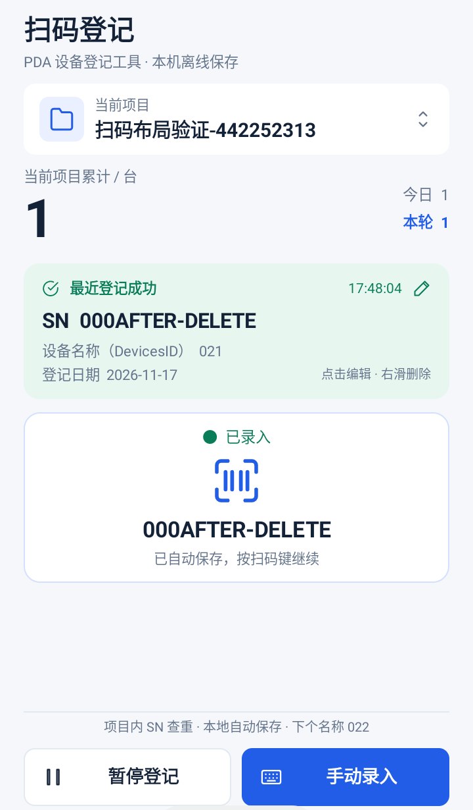
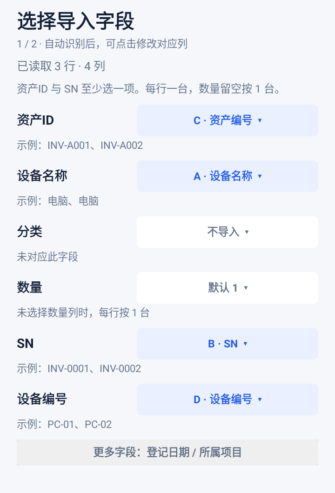
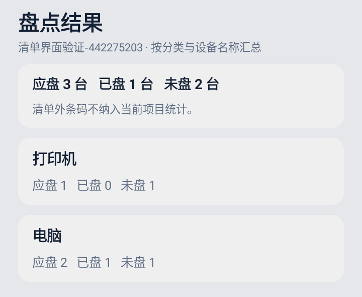

# PDA 扫码登记工具

用于设备登记和固定资产盘点的 Android 离线工具。按 PDA 扫码键即可登记，或导入已有资产清单后逐台盘点；支持 Excel / CSV 导入导出、项目独立编号和蓝牙标签打印。

当前公开测试版：**0.1.13**。**海康机器人 MV-IDP5204 PDA + 德佟 DP30S 蓝牙标签打印机已完成现场蓝牙连接与实际打印测试**，使用 **30 × 20 mm 标签纸**。

## 支持设备

| 设备类型 | 品牌与型号 | 支持情况 |
| --- | --- | --- |
| PDA 扫码终端 | **海康机器人 Hikrobot MV-IDP5204** | 本项目实际使用与验证设备；已有 Android 11 实机回归记录 |
| 蓝牙标签打印机 | **德佟 DP30S** | 已由使用者现场验证蓝牙连接与实际标签打印 |
| 标签耗材 | **宽 30 mm × 高 20 mm 标签纸** | 当前模板和打印规格固定为该尺寸 |
| 其他 Android PDA | Android 8.0 及以上，具备广播输出或键盘输入扫码能力 | 可按接收参数尝试适配，尚未逐型号验证 |
| 其他打印机 | 未验证 | 当前不承诺其他品牌、型号或纸张尺寸兼容 |

MV-IDP5204 的默认接收参数为 Action `com.service.scanner.data`、数据字段 `ScanCode`。本项目不是手机摄像头扫码软件，扫码依赖 PDA 自身读码服务。

## 下载和文档

- **安装包**：在本仓库右侧 **Releases** 下载 `pda-registry-v0.1.13-test.apk`，安装后显示“PDA扫码登记”。
- **[完整图文操作手册](docs/USER_MANUAL.md)**：安装、扫码、盘点、打印与故障排查。
- **[PDF 操作手册](docs/PDA扫码登记-操作手册.pdf)**：可下载离线查看、打印或发给操作人员。
- **[资产盘点导入模板](docs/templates/资产盘点导入模板.xlsx)**：下载原始文件，填写第一张“资产清单”。
- **[开发与构建](docs/DEVELOPMENT.md)** / **[更新记录](CHANGELOG.md)** / **[验证记录](docs/verification/README.md)**。

## 功能

| 场景 | 支持内容 |
| --- | --- |
| 扫码登记 | 识别自动保存、项目内去重、连续编号、手动补录、最近成功记录 |
| 资产盘点 | XLSX / CSV 导入、字段映射、SN 或资产ID核对、已盘 / 未盘筛选、分类汇总、重新盘点 |
| 项目与记录 | 新建、归档、恢复、搜索、编辑、侧滑删除；各项目独立编号和模板 |
| 数据导出 | XLSX / CSV、所选 / 当前筛选 / 整个项目、自选字段、系统保存与分享 |
| 标签打印 | 30 × 20 mm、可编辑模板、逐张预览、指定范围、张数 × 份数、样稿与失败后继续 |
| 操作反馈 | 成功声音与震动、独立异常提示音、试听开关、本机离线保存 |

## 界面预览

截图来自独立验证版演示数据，普通应用的使用流程相同。

| 扫码登记 | 导入字段映射 | 盘点汇总 |
| --- | --- | --- |
|  |  |  |

## 五分钟开始

1. 下载测试 APK，安装并打开。在“项目”页新建项目，选择“扫码登记”。
2. “设置 → 扫码结果接收”选择“直接接收（推荐）”，再到“扫码设备设置 → 启用直接接收”点“启用”。
3. 回到“扫码”页按侧键扫描。成功自动保存；相同项目的重复 SN 不增加设备，也不消耗编号。
4. 在“记录”页查看或勾选，通过“导出表格”保存 Excel，或用“打印所选”准备标签。
5. 已有资产清单时，使用“项目 → 导入项目”，核对字段后创建盘点项目，再扫描清单上的 SN 或资产ID。

## 数据与版本说明

数据保存在 PDA 本机，应用未声明互联网权限。覆盖安装相同包名、相同签名的版本可保留数据；卸载、清除存储或删除项目会删除本机数据。请定期将“整个项目”导出到设备之外保存。

表格导出是业务数据副本，不是完整应用备份。重新导入会创建新盘点项目，不恢复原项目模板、打印次数或盘点历史。当前没有云同步或完整备份还原功能。

当前提供开发签名的公开测试包。已有 37 项隔离实机验证通过，MV-IDP5204 + DP30S 的蓝牙连接与实际打印由使用者现场验证。打印队列保存在进程中，退出后需重新选择未完成设备。

## 仓库结构

```text
app/                    Android 应用与隔离设备测试
  libs/                 本地放置厂商打印 SDK（JAR 不入库）
design/PDA.pen          Pencil 原始界面设计
docs/
  USER_MANUAL.md        图文操作手册
  PDA扫码登记-操作手册.pdf
  images/               手册截图（演示数据）
  templates/            空白资产导入模板
  verification/         不含设备标识的验证记录
scripts/                PDF 手册生成脚本
gradle/                 Gradle Wrapper
```

构建使用 Java 17、Gradle 8.14、AGP 8.11.1、Android API 35，并需自行取得厂商 LPAPI SDK。步骤见开发说明。历史测试包、原始 SDK、设备导出、缓存和签名材料不进入公开仓库。

## 许可与反馈

自行编写的源码、文档和合成提示音采用 [MIT License](LICENSE)，可自由使用和修改。厂商 SDK 等第三方组件适用各自条款，见 [第三方组件说明](THIRD_PARTY_NOTICES.md)。

遇到问题请在本仓库 Issues 提供版本、设备型号、Android 版本、操作步骤及脱敏截图；反馈说明见 [CONTRIBUTING.md](CONTRIBUTING.md)。
