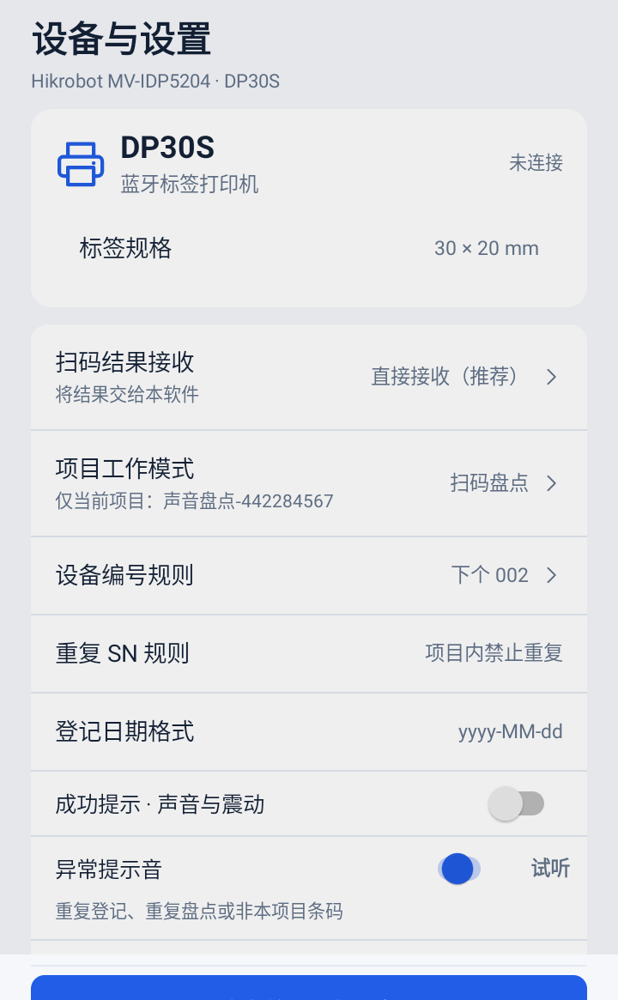
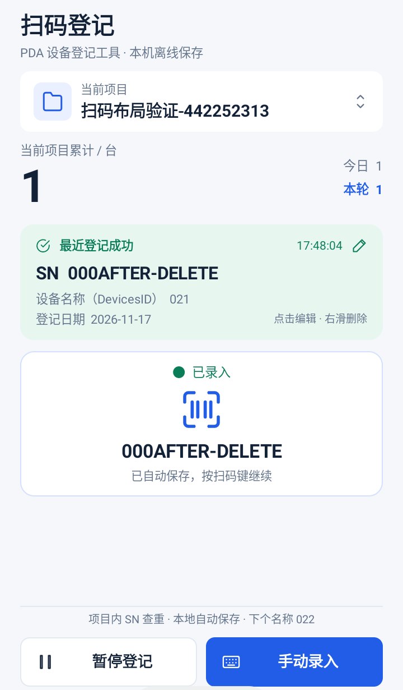
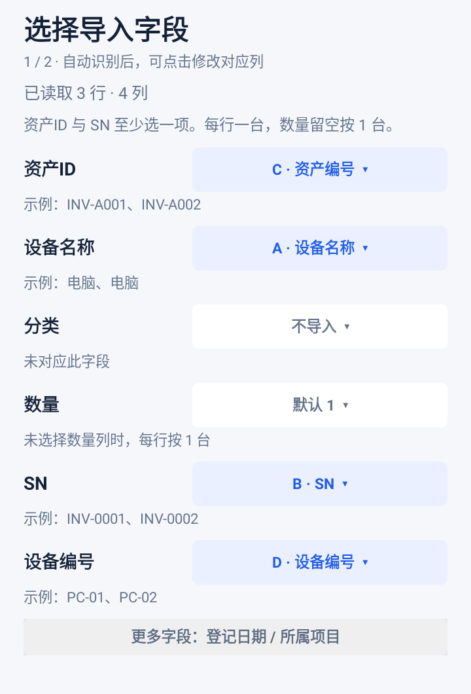
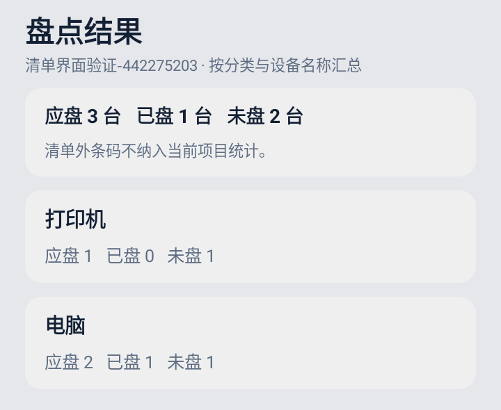
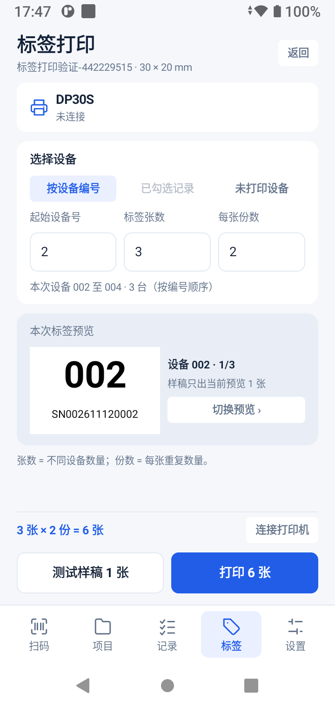
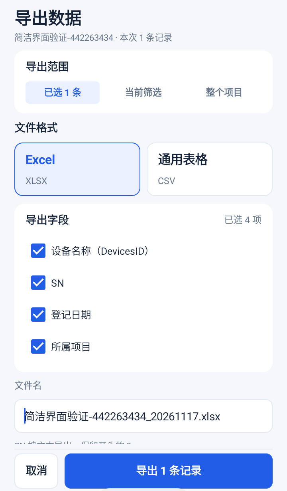

# PDA 扫码登记工具 · 操作手册

适用版本：**0.1.13 公开测试版** | 更新日期：**2026-11-17**

适用人员：现场登记、固定资产盘点、标签操作人员。截图使用独立验证版的演示数据，局部截图聚焦对应操作区域；项目名与 SN 仅作示例。

## 1. 设备、安装与页面

### 1.1 支持设备

| 类型 | 品牌 / 型号 | 说明 |
| --- | --- | --- |
| PDA | 海康机器人 Hikrobot MV-IDP5204 | 本项目实际使用设备；已有 Android 11 实机回归记录 |
| 打印机 | 德佟 DP30S 蓝牙标签打印机 | 使用者已现场确认蓝牙连接及实际打印正常 |
| 标签纸 | 宽 30 mm × 高 20 mm | 当前模板与打印规格固定为该尺寸 |
| 其他 PDA | Android 8.0 以上，支持广播或键盘输入扫码 | 可尝试适配，其他型号尚未逐一验证 |
| 其他打印机 | 未验证 | 当前不承诺其他品牌、型号及纸张尺寸兼容 |

本工具依赖 PDA 自身读码服务，不提供手机摄像头扫码。请准备充好电的 PDA；打印时还需装好标签纸并开启打印机。

数据自动保存在当前 PDA，可离线使用。没有账号登录、云同步或多机自动合并，各 PDA 分别保存自己的数据。

### 1.2 安装与升级

1. 在 GitHub 仓库右侧 Releases 下载 `pda-registry-v0.1.13-test.apk`，传到 PDA。
2. 在 PDA 文件管理器中打开 APK，按系统提示允许该文件管理器安装应用，再点“安装”。单位设备限制安装时联系设备管理员。
3. 从应用列表打开“PDA扫码登记”；首次出现添加桌面入口提示时可选择添加。
4. 已安装旧版时，先导出实际项目，再用同包名、同签名的 APK 覆盖安装。

**不要为了升级先卸载旧版。** 卸载和“清除存储空间”会删除本机数据。出现签名冲突时，保留现有应用并联系维护者；自行编译的包可能使用不同签名。

“PDA登记验证”是独立测试应用，日常请打开“PDA扫码登记”。设置页底部可查看版本。可从“设置 → 桌面入口 → 添加桌面图标”再次添加入口。

### 1.3 页面与工作模式

| 页面 | 用途 |
| --- | --- |
| 扫码 | 当前项目连续登记或盘点、暂停 / 继续、手动输入 |
| 项目 | 新建、导入、搜索、切换、归档 / 恢复、删除项目 |
| 记录 | 搜索、筛选、勾选、编辑 / 删除、导出或打印 |
| 标签 | 编辑当前项目的 30 × 20 mm 标签模板 |
| 设置 | 打印机、扫码接收、项目模式、编号与提示音 |

**扫码登记**：新的 SN 新增一台设备，自动分配编号。**扫码盘点**：按已有清单核对 SN 或资产ID，只标记已盘点，清单外条码不新增设备。操作前先检查项目卡片中的项目名与工作模式。

## 2. 首次配置扫码

### 2.1 直接接收（推荐）

1. 打开“设置 → 扫码结果接收”，选择“直接接收（推荐）”。
2. 打开“设置 → 扫码设备设置 → 启用直接接收”，点“启用”。
3. 返回扫码页，确认项目未归档且未暂停，关闭所有弹窗。
4. 按 PDA 侧键识别测试条码，识别后自动处理，无需再点确认。

启用指令面向海康 PDA 扫码服务。其他厂商设备应在系统扫码配置中选择广播输出，再核对接收参数。

### 2.2 填入输入框（备用）

设备只能将扫码结果当键盘输入时，选择“填入输入框（备用）”。在设备扫码服务中设置条码后追加回车，返回扫码页并保持输入框焦点。回车会自动处理，也可点“登记输入内容”。

按所选模式配置一条输出链路，避免同一条码同时经过广播和键盘输入两次。

### 2.3 高级接收参数

| 参数 | 默认值 |
| --- | --- |
| 接收标识（Action） | `com.service.scanner.data` |
| 条码数据字段 | `ScanCode` |

入口：“设置 → 高级接收设置”。仅在设备确实使用其他参数时修改，大小写须与设备配置一致。

应用只在扫码页前台、没有弹窗且未暂停时自动处理条码；切到其他页面不会继续自动登记。

## 3. 扫码登记

### 3.1 新建项目与连续登记

1. 在项目页点“＋ 新建项目”，填写 1-60 字符的唯一项目名，选择“扫码登记”，点创建。
2. 返回扫码页确认项目名，按侧键识别条码。
3. 右上角出现“录入成功”，累计数量加一，最近成功记录显示设备编号、SN 和日期。数据已自动保存。
4. 可立即扫描下一台，不必等待提示消失。下次扫码键触发后输入区域清空并等待新结果。
5. 临时停止时点“暂停登记”，恢复时点“继续登记”；无可读条码时使用手动输入入口补录。

成功提示约 1.5 秒后消失，已识别的 SN 保留至下次扫码键触发；保留文字不表示尚未保存。

### 3.2 重复、编号与统计

- 项目内重复 SN 显示“SN重复”，不新增记录、不增加数量、不消耗编号。
- 去掉 SN 首尾空白，保留前导零与大小写；查重区分大小写，`abc001` 与 `ABC001` 是不同文本。
- 不同项目可保存相同 SN，请先确认当前项目。
- 默认编号 `001`、`002`、`003`。删除不回收编号；删除 `002` 后，下一台不会改回 `002`。
- 日期使用 PDA 本地日期，作业前请检查系统时间。
- “本轮”为当前应用会话中的新增数，“累计”为项目总数。退出后本轮可能重新开始，已保存记录仍保留。

## 4. 导入资产清单

### 4.1 填写模板

下载随附的“资产盘点导入模板.xlsx”。填写第一张“资产清单”；第二张“填写说明”中的示例不会导入。

| 字段 | 填写方式 |
| --- | --- |
| 资产ID | 如 `ZC-000001`，与 SN 至少有一项实际值 |
| 设备名称 | 如“办公电脑”，表示业务名称或设备类型 |
| 分类 | 如“计算机”“办公设备”，用于分类汇总 |
| 数量 | 每台独占一行，只能为 1 或留空 |
| SN | 实际条码或序列号，保留大小写和前导零 |
| 设备编号 | 可选，如 `PC-001`；留空时自动生成 |

**SN、资产ID必须先在 Excel 中设为文本，再输入值。** 已被转换成数字、科学计数法或丢失前导零的内容，改格式不能找回原值，应从原始资料重填；不要用公式生成识别码。

每台独占一行，至少有 SN 或资产ID。设备名称、分类可按组填写一次，后续空白沿用上一行；SN、资产ID和设备编号不向下补值。不要将多台合并成“数量 20”的一行。

### 4.2 选择文件与对应字段

1. 将清单传到 PDA，在项目页点“导入项目”，通过系统文件选择器打开 XLSX 或 CSV。
2. 在“选择导入字段”核对自动识别结果。点字段右侧选择实际列，或选择“不导入此字段”。
3. 对照原列字母、列名与示例检查映射；日期和所属项目在“更多字段”中。
4. 点下一步查看预览，填写项目名，核对应盘总数、分类和示例。
5. 点“导入并开始盘点”，创建新的盘点项目。

设备名称是“办公电脑”等业务名称；设备编号是 `PC-001` 或 `001` 等唯一显示编号，不要映射反。同一原列不能同时对应两个字段。

### 4.3 文件与校验规则

- 支持 XLSX、CSV；旧 `.xls` 先另存为 XLSX 或 CSV。
- XLSX 只读第一张工作表，第一条非空行为表头。CSV 支持 UTF-8，无法解码时尝试 GB18030。
- 每文件创建一个新盘点项目，不追加或覆盖已有项目；“所属项目”列不能混用多个项目名。
- 文件不超过 32 MB；有效设备 1-50000 台，表头最多 256 列。大清单先用少量数据试导。
- SN、资产ID在整个清单中须唯一，不能跨设备交叉重用；同一设备两者可相同。
- 设备编号不能重复，日期格式为 `yyyy-MM-dd`。
- 校验失败按提示行号修正原文件后重选；不会留下部分导入的项目。

## 5. 扫码盘点

### 5.1 核对设备

1. 导入后进入该项目扫码页，确认“已盘点 / 应盘点”。
2. 扫描清单中的 SN 或资产ID。成功显示“盘点成功”，已盘加一并保存盘点时间。
3. 重复扫描显示“已盘点”，不重复累计。清单外条码显示“不属于当前项目”，不新增设备。
4. 在记录页按“已盘”“未盘”筛选，也可搜索 SN、资产ID、设备名称、编号或分类。
5. 点扫码页“盘点结果”，按分类与设备名称查看应盘、已盘、未盘。

### 5.2 模式切换与新一轮盘点

“设置 → 项目工作模式”只修改当前项目。登记项目可切换为盘点模式核对已有记录；空盘点项目没有清单，扫描不会新增设备。已有 Excel 清单时直接使用“导入项目”。

开展新一轮前先导出当前结果，再到“盘点结果 → 重新盘点”确认。该操作清除本项目的已盘状态和盘点时间，保留清单；旧结果不会作为历史轮次自动保留。

编辑已盘设备的 SN 会清除该设备盘点状态，修改后应重新扫描。清单导出后重新导入也不会恢复原盘点状态。

## 6. 记录与项目管理

### 6.1 搜索和勾选

记录页点击放大镜展开搜索；取消可清除搜索并收起键盘。登记模式有“全部 / 今日 / 未打印”，盘点模式有“全部 / 已盘 / 未盘”。切换筛选不删除记录。

左侧复选框逐条选择。“全选”选择当前已加载且符合筛选的记录；多于首批记录时先点“显示更多记录”再全选。“清空”只清除勾选，不删除数据。完整导出请直接选择“整个项目”。

### 6.2 编辑与删除记录

点记录卡片进入编辑，修改编号数字部分、SN 或日期。完整编号实时预览，沿用项目前缀与位数。点保存才生效，取消则放弃。

保存会校验有效日期、SN 和编号，冲突时不保存。调大编号推进后续编号，调小和删除不回退。原记录身份、创建时间和打印次数保留，已打印标签需自行补打。

向左或向右滑动可露出删除按钮，编辑页也可删除；确认后不能撤销。扫码页最近成功登记记录也支持编辑与侧滑删除。

### 6.3 归档和删除项目

归档停止录入，保留记录、编号和模板；恢复后可继续。归档不是导出或备份。

侧滑项目卡片露出删除，确认后删除项目全部记录、盘点状态与模板。最后一个项目删除后会创建空的默认项目。请先导出需要保留的数据。

有未完成打印任务时，先完成或取消任务，再编辑、删除或修改编号规则。

## 7. 设备编号规则

入口：“设置 → 设备编号规则”，按项目独立保存。

| 项目 | 范围 / 示例 |
| --- | --- |
| 名称前缀 | 可空，最多 20 字符；如需分隔符直接填 `SB-` |
| 编号位数 | 1-10 位，不足补零，超出继续增长 |
| 起始编号 | 非负整数，如 0、1、100 |

例：前缀 `SB-`、3 位、起始 0，生成 `SB-000`、`SB-001`、`SB-002`。

**保存规则会按原编号顺序统一重新编号本项目已有记录。** 请先核对连续三个编号与下次扫码编号预览。SN、日期保留，其他项目不受影响；已出纸标签不会自动重打。导入的自定义编号也应事先导出留存。

打印页起始设备号填写数字部分，如 `SB-003` 填 `3`。导入的任意自定义编号建议通过勾选记录打印，准确控制范围。

## 8. 标签模板与打印

### 8.1 连接德佟 DP30S

1. 装入 30 × 20 mm 标签纸，打印机开机并靠近 PDA。
2. 设置页点“搜索并连接打印机”，允许请求的权限并启用蓝牙。
3. 点“搜索附近打印机”，选择对应 DP30S，等待显示“已连接”。打印页也有连接入口。
4. Android 12 以上需要附近设备 / 蓝牙权限；旧版系统蓝牙扫描可能请求位置权限。

海康 MV-IDP5204 与德佟 DP30S 的蓝牙连接和实体打印已由使用者现场验证。其他设备型号需另外确认。

### 8.2 编辑 30 × 20 mm 模板

在标签页调整每行内容、字号、粗细、对齐、文本框宽度及 X / Y 毫米坐标，也可拖动预览文字。左上角为原点。模板属于当前项目，应用修改后可点保存。

| 字段 | 内容 |
| --- | --- |
| `{设备名称}` / `{DevicesID}` | 设备编号，如 `SB-001` |
| `{SN}` | 条码 / 序列号 |
| `{日期}` | 登记日期 |
| `{项目}` | 所属项目名 |

默认是大号编号与小号 SN，可混合固定文字，如 `SN：{SN}`。这里 `{设备名称}` 是原登记字段，表示编号，不是导入表“办公电脑”等业务名称。不要使用未支持占位符。

过长文字会缩小以适应宽度，长 SN 需打样确认可读性。当前输出文字，不会自动生成条形码或二维码图形。

### 8.3 来源、张数和份数

从记录页勾选后点“打印所选”，或从标签页点“标签打印”。

| 来源 | 范围规则 |
| --- | --- |
| 按设备编号 | 从已登记起始设备号开始，按编号取指定数量 |
| 已勾选记录 | 只从勾选记录中按编号取数，不加入其他设备 |
| 未打印设备 | 只从未打印记录中取数，起始设备号为下限 |

标签张数是不同设备数，每张份数是每台重复几张，份数为 1-99。例如 3 台 × 2 份 = 6 张，顺序 A、A、B、B、C、C。

标签页进入默认 1 × 1；勾选进入默认等于所选设备数。核对总量与范围，用“切换预览”逐台检查后打印。数量不足、编号不存在或输入无效时先修改输入。

### 8.4 打样、暂停与恢复

“测试样稿 1 张”仅打当前预览一张，不受正式份数影响，不新增记录、不占编号、不增加打印次数。空项目可用标明示例设备的预览打样。

正式打印收到匹配的 SDK 成功回调才累计次数。暂停会在当前张完成后生效，失败或断线也会暂停。继续前核对最后一张实物，避免已出纸但未回传状态的标签重复打印。

队列保存在应用进程中，退出或被系统终止后不会自动恢复。重新打开后按实际出纸情况核对未完成范围，再从记录页选择。更换纸张或修改模板后，先打 1 张样稿确认方向、边距和清晰度。

## 9. 导出与数据保存

### 9.1 导出步骤

1. 记录页点“导出表格”，或盘点结果页点“导出结果”。
2. 选已选记录、当前筛选或整个项目，核对本次记录数。
3. 选 Excel（XLSX）或 CSV，勾字段并填文件名。
4. 点导出，在系统文件选择器中选位置保存，等待“导出完成”。
5. 可分享文件，或从文件管理器复制到电脑 / U 盘；可用保存位置取决于设备文件选择器。

登记字段为设备名称（DevicesID）、SN、登记日期、所属项目。盘点模式还有业务设备名称、资产ID、分类、盘点状态、盘点时间和数量，建议保留这些字段。

XLSX 编号按文本输出。CSV 为带 BOM 的 UTF-8，Excel 应使用“从文本/CSV”并把编号列设为文本；直接双击可能转换数字、丢失前导零。

### 9.2 保存和还原边界

完成任务或重大修改前，将整个项目导出并复制到 PDA 之外。打开文件检查行数、编号与盘点状态，再删除或重新盘点。

**导出表格不是完整应用备份。** 重新导入只创建新盘点项目、读入可映射清单字段，不恢复项目身份、模板、打印次数、盘点状态 / 时间或历史轮次。旧盘点结果请保留原导出文件。

卸载、清除存储、删除项目、删除记录和重新盘点分别影响不同数据，应用无回收站。同签名覆盖安装可保留数据，但升级前仍应先导出。

## 10. 提示音与常见问题

### 10.1 声音设置

“成功提示 · 声音与震动”控制成功反馈。“异常提示音”独立控制重复登记、重复盘点、非本项目条码和保存失败的双音提示；“试听”可直接播放。声音使用媒体音量，关闭异常音后仍显示文字提示。

### 10.2 故障排查

| 现象 | 处理 |
| --- | --- |
| 扫码没有自动处理 | 返回扫码页，恢复未暂停状态并关闭弹窗；核对输出模式、Action 与字段 |
| 填入框但不保存 | 备用模式设置追加回车并保持焦点，或点登记输入内容 |
| SN重复 / 已盘点 | 本项目已有记录或已核对，不再次累计；检查项目与 SN |
| 不属于当前项目 | 盘点模式条码不在清单；核对项目、SN 和资产ID |
| 编号与原编号不同 | 检查是否保存了编号规则，该操作会重新编号已有记录 |
| 无法导入 / 某行错误 | 检查格式、第一张表、映射、文本码、数量 1、重复码和大小 |
| SN 前导零丢失 | 使用 XLSX；输入前设文本，已丢失的零从原值重填 |
| 找不到导出文件 | 确认保存位置与导出完成提示，通过分享或文件管理器定位 |
| 全选少于项目总数 | 全选只含已加载筛选记录；显示更多，或导出整个项目 |
| 搜不到 / 连不上 DP30S | 核对电量、距离、蓝牙与附近设备 / 位置权限，再搜索 |
| 打印中断 | 检查纸张、最后一张和未完成范围，避免重复发送已出纸标签 |
| 异常音无声 | 提高媒体音量、打开异常音并试听，检查静音状态 |
| 无法编辑 / 改编号 | 先完成或取消当前打印任务 |
| 升级签名冲突 | 保留现有应用，先导出并联系维护者，不要直接卸载 |

### 10.3 反馈问题

在 GitHub 仓库 Issues 提供版本、设备型号、Android 版本、操作步骤、预期与实际结果。表格问题用少量虚构数据复现。截图与附件遮盖真实清单、SN、蓝牙地址与个人信息，保留长度、前导零和大小写等格式特征。

开发构建与隔离验证见 `docs/DEVELOPMENT.md`；空白模板在 `docs/templates/`；PDF 可从仓库文档目录或 Releases 下载。
